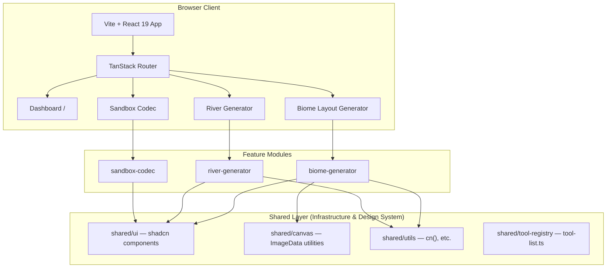

# 7DTD Game Tools

A high-performance, modular web-based toolkit for **7 Days to Die (7DTD)** server administrators, modders, and players. Built with a modern, reactive stack, it is designed for speed, flexibility, and a polished user experience.

## Tools & Features

### Biome Layout Generator (`/7dtd/biome-layout-generator`)
A highly configurable procedural generation engine that allows creators to instantly design regional biome structures.

* **10 Generation Algorithms**: Craft layouts using Random Seeds, Territory Expansion, Random Walkers, Random Blobs, Cellular Growth, Probability Fields, Recursive Split, Weighted Expansion, Biome Islands, and Climate Clustering.
* **Noise Mode**: Utilize Simplex, Perlin, Fractal, or Worley noise fields with configurable frequency, octaves, persistence, and lacunarity.
* **Multithreaded Processing**: Offloads heavy noise calculations and median filtering to Web Workers so the UI never drops a frame.
* **Smart Presets**: Out-of-the-box configurations for 7 Days to Die (5 biomes), Minecraft (7 biomes), Valheim (9 biomes), and Standard Earth (9 biomes).

### River Generator (Feature Module)

A shared procedural river generation engine integrated into the Biome Layout Generator for 7 Days to Die maps, based on a fractal midpoint displacement algorithm with Perlin noise width variation.

* **Midpoint Displacement Algorithm**: Recursive fractal subdivision that produces self-similar meandering river centerlines with natural-looking bends across all scales.
* **Disk Stamp Rasterization**: River paths are rasterized by stamping overlapping disks with Perlin noise width variation, producing smooth, continuous water channels.
* **Configurable Parameters**: Tune river density, meander factor, width, and noise characteristics per generation.
* **Shared Feature Architecture**: Operates as a cross-tool feature module. Core logic lives in `src/features/river-generator/core/` with zero React dependencies, consumed directly by the Biome Layout Generator's `GeneratorControls` component.

### Sandbox Codec (`/7dtd/sandbox-codec`)
An interactive encoder and decoder for the V3.0 Sandbox Server Preset Codes introduced in 7 Days to Die.

* **Bi-directional Encoding/Decoding**: Easily convert a compact alphanumeric string back into editable options or vice versa.
* **120+ Options Configured**: Covers all core gameplay multipliers, settings, and flags.
* **Live Code Preview**: Encodes in real-time as you tweak slider values, toggles, or drop-downs.
* **Dependency System**: Options react to user selections (e.g., setting XP Multiplier to 0 automatically hides and disables Show XP).
* **Schema-backed Safety**: Warns about invalid entries, unknown values, and out-of-range inputs gracefully without crashing the app.

## Architecture Overview

The app is built as a single-page application (SPA) with tool-scoped state management to ensure high modularity and zero coupling between different tool routes. All feature modules depend only on the shared infrastructure layer — never on each other.



### Project Structure

```
src/
  features/                         — Self-contained tool modules
    biome-generator/                — Biome Layout Generator
      components/                   — UI components (Controls, Canvas, List)
      context/                      — Tool-scoped React Context
      core/                         — Pure generation algorithms (no React deps)
      workers/                      — Web Workers for offloaded generation
      types/                        — Tool-specific TypeScript types
    river-generator/                — River Generator (Shared Feature)
      components/                   — RiverControls UI component
      core/                         — Walker, noise, stamp algorithms (no React deps)
      workers/                      — Web Worker for offloaded river generation
      types/                        — WaterMap, RiverGenParams types
    sandbox-codec/                  — Sandbox Codec
      components/                   — UI components (Panels, Controls)
      core/                         — Encode/decode library (no React deps)
  shared/                           — Cross-feature utilities (features → shared, never shared → features)
    ui/                             — shadcn/ui base components
    hooks/                          — Shared React hooks (useIsMobile)
    utils/                          — Utility functions (cn)
    canvas/                         — Canvas/ImageData utilities
    tool-registry/                  — Tool definitions (tool-list.ts)
    types/                          — Shared TypeScript types
    constants/                      — Shared constants (future use)
  app/                              — App-level framework setup
    theme/                          — ThemeProvider (dark/light mode)
    providers/                      — App-level providers
    router.ts                       — TanStack Router creation (extracted from main.tsx)
  routes/                           — TanStack Router file-based route pages
    7dtd/
      biome-layout-generator/
      sandbox-codec/
```

### Architecture Principles

- **Feature-first, decoupled**: Each tool is fully self-contained under `features/<tool-name>/` with its own components, context, core logic, workers, and types. Feature modules never import from each other — all dependencies flow to `shared/`.
- **Shared feature modules**: Capabilities shared across tools (e.g., `river-generator`) live in `features/<shared-feature>/` and expose `core/` and `types/` for cross-feature imports — never a circular dependency.
- **One-way dependency**: Features import from `shared/`, never the reverse. Core logic (`features/*/core/`) is pure TypeScript with zero React or UI dependencies.
- **Shared baseline**: Cross-cutting concerns (shadcn/ui components, hooks, utils, canvas utilities) live in `shared/` and are consumed by all feature modules.

## Tech Stack

- **Runtime**: Bun (v1.3.14+) — fast package installer and task runner
- **Bundler**: Vite 8 + React 19 — fast refresh and advanced rendering
- **Language**: TypeScript 7 — strict mode, bundler module resolution, `verbatimModuleSyntax`
- **Routing**: TanStack Router v1 — fully type-safe, file-based routing
- **Styling**: Tailwind CSS v4 — CSS-first architecture with OKLCH color spaces
- **UI Foundation**: shadcn/ui v4 (`base-nova` style, `@base-ui/react` primitives, Lucide React icons, `sonner` toasts)
- **Code Quality**: oxlint — ultra-fast Rust-based linter

## Getting Started

```bash
bun install
bun run dev
```

## Scripts

| Command | Description |
|---|---|
| `bun run dev` | Start Vite dev server (port 5173) |
| `bun run build` | `tsc -b && vite build` — typecheck then bundle |
| `bun run preview` | Preview production build |
| `bun run lint` | Run oxlint |

## Adding a Tool (For Developers)

This project is built to expand to other games and features easily. To add a new tool:

0. **Check for shared features**: Before scaffolding a new module, browse `src/features/` for existing shared capabilities (e.g., `river-generator`). Compose them into your tool rather than reimplementing.
1. Create a route page at `src/routes/<game>/<tool-name>/index.tsx`. The TanStack Router plugin auto-registers the route on dev/build.
2. Create a feature folder at `src/features/<tool-name>/` with subdirectories: `components/`, `core/`, `hooks/`, `context/`, `types/` (add only what you need).
3. Core logic goes in `features/<tool-name>/core/` — pure TypeScript, no React dependencies.
4. Track tool-specific state inside its own Context provider in `features/<tool-name>/context/` or local page state (avoid global variables).
5. Register the tool in `src/shared/tool-registry/tool-list.ts` — its entry (title, href, gameCategory, icon) automatically populates both the sidebar nav and the home page card grid.
6. If your tool reuses an existing shared feature (like `river-generator`), import its core types and logic directly from `@/features/<shared-feature>/core/` — no need to duplicate.
7. Import shadcn components from `@/shared/ui/` and shared utilities from `@/shared/`.
